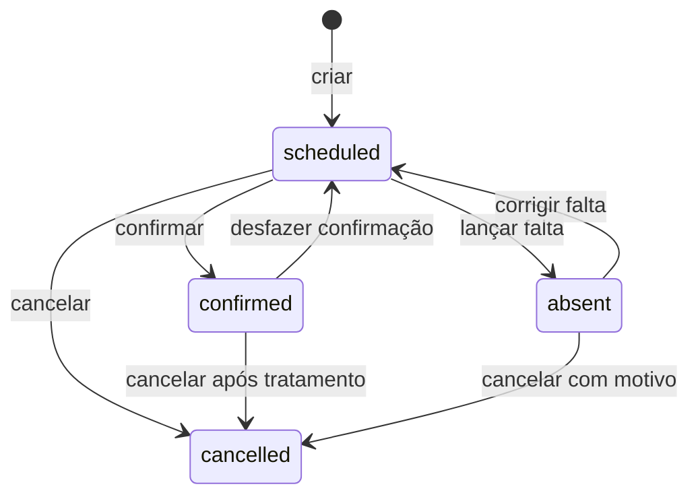
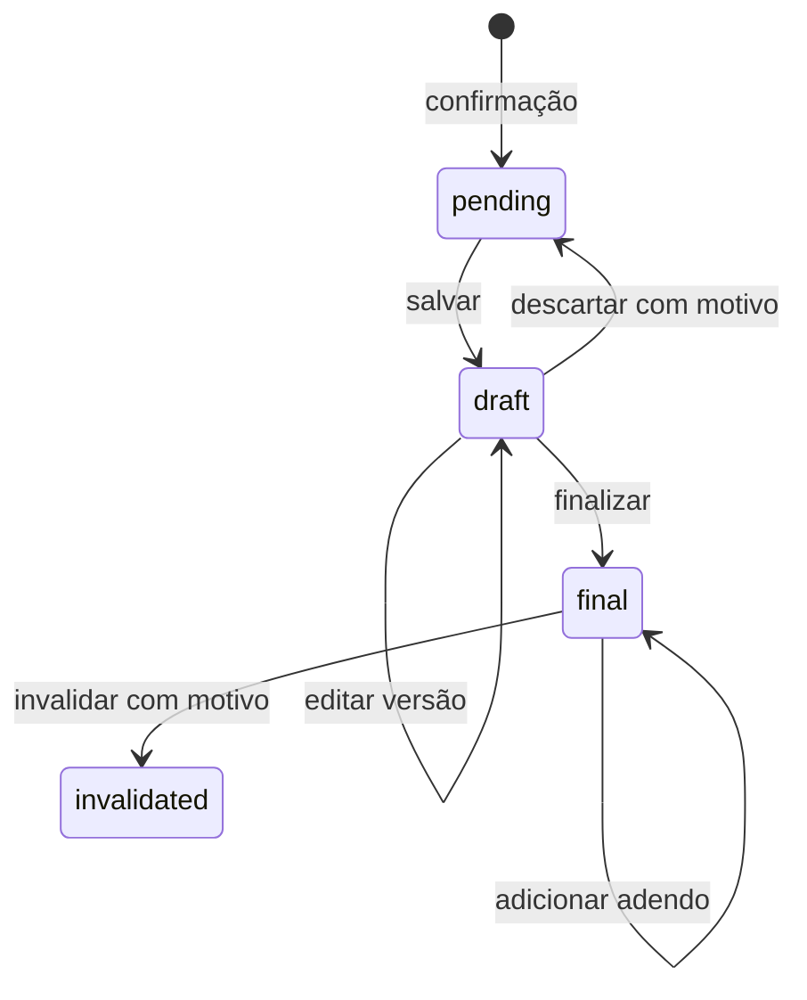

# SPEC 01 CP-01 | ADRs D01–D08 e máquinas de estados

**Estado dos ADRs:** princípios de desenho aprovados com ressalvas em 16/10/2026. Nenhum deles substitui a aprovação da regra de negócio, assistencial, financeira ou de privacidade indicada. Alternativas rejeitadas aqui significam inadequadas à hipótese atual, não decisão contratual definitiva.

| ADR | Desenho adotado para CP-01 e alternativa | Consequência e validação pendente |
| --- | --- | --- |
| D01 Cadastro | Paciente único por organização, vínculo N:N com unidades; rejeitar cópia de cadastro por unidade. | Transferência e deduplicação facilitadas, mas leitura de dados pessoais exige escopo. Clínica e privacidade definem identidade, duplicados e histórico entre unidades antes de CP-02. |
| D02 Administração | Concessão central em `role_grants` com aprovador, vigência e revogação; gestor local pode solicitar. Evitar autoatribuição pelo perfil. | Revogação consultada a cada comando. Clínica indica administradores, substitutos e alçada; convite, suspensão e dupla aprovação pendentes. |
| D03 Auth | Supabase Auth identifica; servidor e RLS consultam vínculos ativos no banco. Evitar autorização só por tela ou claim editável. | Dupla defesa e custo de políticas/consultas. Equipe técnica valida desempenho, sessão, grants e acesso negativo em CP-02. |
| D04 Agenda | Exclusividade de paciente e profissional para slots ativos, atravessando unidades. Evitar aceitar colisão por padrão. | A regra exata de intervalo, duração, grupo e encaixe depende da clínica; CP-03 não pode fixar uma constraint de intervalo sem esse aceite. |
| D05 Manutenção | Mesmo ID, eventos append-only, motivo e pré-condições. Reabertura de slot testa colisão sob lock. Evitar exclusão/recriação. | Atendimento confirmado exige resolução clínica e financeira antes de reversão. Clínica confirma prazos, cancelamento tardio e alçadas antes de CP-03. |
| D06 Produção | Capturar regra e valores por ciclo na confirmação, independente da evolução. Evitar recalcular passado com regra atual. | R$ 120 e R$ 18 são dados demonstrativos; Financeiro/clínica aprovam tabelas, glosas e vigências antes de CP-04. |
| D07 Conciliação | Contas independentes com eventos monetários, inclusive parciais e ajustes, saldo derivado. Evitar apenas booleanos do MVP. | Mais estados e reconciliação; Financeiro define tolerâncias, quem ajusta e estorna, e evidência de recebimento antes de CP-04. |
| D08 Clínica | Rascunhos versionados, final congelado, adendos e invalidação justificada sem exclusão. Evitar sobrescrever final. | Responsável técnico e privacidade aprovam retificação, autoria, acesso emergencial e retenção antes de CP-04 e operação real. |

## Estados dos atendimentos

`cancelled` é terminal para o ciclo demonstrado; recriar ou restaurar cancelado dependerá de regra expressa da clínica. Edição e transferência de `scheduled` são transições internas que preservam ID e incrementam versão. O fluxo do MVP permite cancelar confirmado somente depois de resolver conciliação e evolução; não se apaga nota. Ações recusadas não emitem produção nem novo evento de estado; tentativa negada pode ser registrada em log de segurança sem conteúdo clínico.

| Transição | Pré-condições mínimas | Efeitos atômicos |
| --- | --- | --- |
| criar/editar/transferir | paciente/profissional/unidade ativos; permissão; slot livre; versão esperada | conservar ID na manutenção, atualizar unidade/horário, evento com antes/depois e motivo |
| confirmar | `scheduled`, bloqueios/exceção aplicáveis, permissão e versão | `confirmed`, evento, ciclo de produção e duas contas uma vez, pendência clínica; sem depender de evolução |
| falta | `scheduled`, permissão | `absent`, evento, sem produção |
| corrigir falta | `absent`, motivo, slot ainda livre | `scheduled`, evento, sem produção; conflito retorna erro |
| desfazer confirmação | `confirmed`, motivo, sem evolução ativa ou com invalidação explícita, contas reabertas | `scheduled`, evento, reversão compensatória do ciclo, atualização de saldos e pendências |
| cancelar | motivo, estado elegível, tratamento clínico/financeiro se confirmado | `cancelled`, evento; ciclo ativo revertido quando aplicável |

## Estados clínicos

Uma invalidação conserva nota, versões e adendos; a abertura de uma nova nota substitutiva e o acesso emergencial dependem de regra clínica. `pending` é uma projeção do atendimento confirmado sem nota ativa, não um prontuário vazio com permissões amplas. Adendo referencia versão final, autor e instante. O calendário lateral filtra agenda de Recepção e Profissionais, sem alterar estado de atendimento.

## Estados financeiros propostos

Cada conta possui `valor_original`, soma de ajustes e soma de eventos de liquidação válidos. `aberta` se saldo positivo; `parcial` se houve liquidação e saldo positivo; `conciliada` se saldo zero; `reaberta` após evento compensatório; `revertida` quando o ciclo de produção é compensado. Não permitir saldo negativo ou reversão de ciclo com conciliação ativa. Pagamento e recebimento seguem trilhas independentes. Os detalhes contratuais desses estados ainda precisam de D06–D07.
