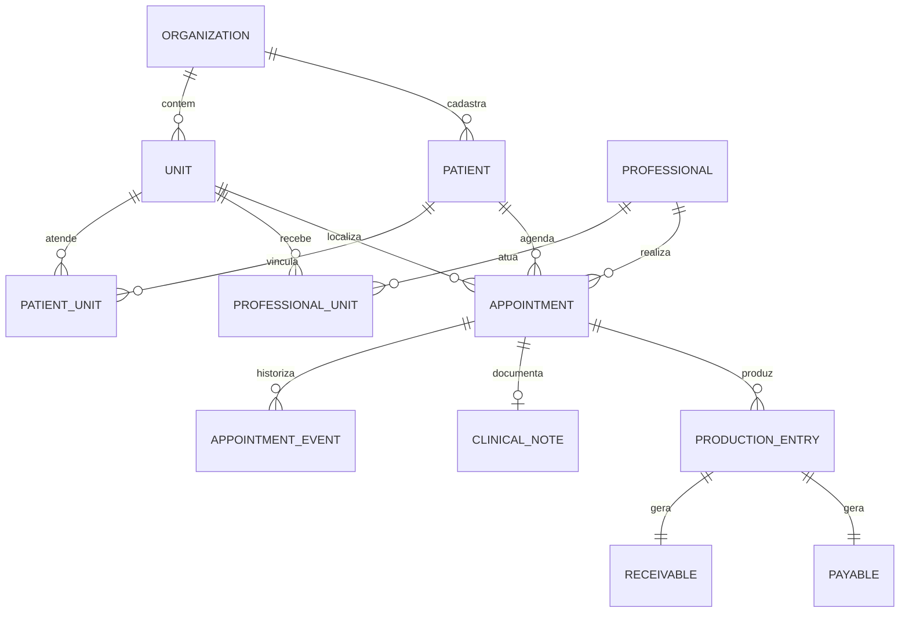

# SPEC 01 CP-01 | Modelo lógico e invariantes

**Natureza:** contrato de desenho, sem SQL e sem provisionamento. Hipóteses aprovadas para arquitetura não substituem aceite operacional da clínica. `organization_id` delimita o tenant; o piloto terá duas unidades, mas os IDs não são fixos. PKs UUID, FK explícitas, horários em UTC com fuso de exibição da unidade, dinheiro em centavos inteiros ou `numeric(12,2)`, `version` para registros mutáveis. O esquema físico e índices serão revisados no CP-02.

## Relações e cardinalidades

| Entidade | Campos e relacionamentos essenciais | Cardinalidade e restrições propostas |
| --- | --- | --- |
| `organizations` | `id`, nome operacional | 1 organização tem N unidades, pacientes, usuários e regras; fronteira de tenant obrigatória em cada FK operacional |
| `units` | `id`, `organization_id`, fuso, ativa | N por organização; duas no cenário sintético; um atendimento pertence a uma unidade por vez |
| `user_profiles` | `user_id` FK `auth.users`, `organization_id`, ativo | 1 identidade Auth pode ter N vínculos; revogação não apaga eventos históricos |
| `role_grants` | `user_id`, papel, escopo organização/unidade, aprovador, vigência, revogação | N por usuário; concessão central explícita e auditada; papel e unidade ativos avaliados no banco por requisição |
| `professional_profiles` | `id`, `organization_id`, `user_id` opcional, especialidade | Profissional de agenda pode existir antes do convite de login; vínculo Auth quando acesso clínico for concedido |
| `professional_units` | `professional_id`, `unit_id`, vigência | N:N; agendar ou transferir exige vínculo ativo no horário; revogação não apaga atendimento passado |
| `patients` | `id`, `organization_id`, identificação mínima, estado cadastral | 1 paciente por organização pode atender em N unidades; deduplicação/identidade real pendente da clínica |
| `patient_units` | `patient_id`, `unit_id`, origem do vínculo, vigência | N:N, uso operacional por unidade; não concede automaticamente leitura clínica de outra unidade |
| `insurers`, `patient_coverages` | convênio, paciente, carteira, vigência | Convênio 1:N coberturas; paciente 1:N coberturas; unicidade de carteira sujeita a D01 e política da clínica |
| `appointments` | `id`, organização, paciente, profissional, unidade, início, fim/duração pendente, status, `version` | paciente/profissional/unidade na mesma organização; ID preservado em todas as transições; horários ativos não colidem conforme D04 |
| `appointment_events` | atendimento, sequência, ação, ator, antes/depois mínimos, motivo, instante | 1:N append-only; um evento por transição efetiva; histórico de transferência guarda unidades anterior e nova |
| `policy_versions`, `appointment_exceptions` | regra/versão/vigência; exceção, escopo, motivo, aprovador | N versões por regra; exceção vinculada ao atendimento e política vigente; não reescrever fatos anteriores |
| `clinical_notes` | atendimento, autor profissional, status, versão corrente, finalizado/invalidação | 0:1 nota principal por atendimento confirmado; corpo isolado em schema privado ou tabela sem grant amplo |
| `clinical_note_versions` | nota, número, conteúdo, autor, instante | 1:N enquanto rascunho; finalização referencia versão congelada; nenhuma versão é sobrescrita |
| `clinical_addenda`, `clinical_invalidation_events` | nota, autor, conteúdo ou motivo, instante | 0:N; adendo novo sem alterar final; invalidação explícita conserva nota e trilha |
| `production_entries` | atendimento, profissional, unidade, convênio e regra fotografados, valor, estado | 0:1 produção ativa por confirmação vigente, com chave única de ciclo/atendimento; reversões preservam lançamentos anteriores |
| `receivables`, `payables` | produção, valor original, ajustes, saldo/estado derivado | 1:1 de cada tipo por produção; pagamento/recebimento independentes; nenhum depende de evolução clínica |
| `settlement_events`, `financial_adjustments`, `financial_reversal_events` | conta/produção, tipo, valor, referência, motivo, ator | 0:N append-only; saldo por soma de eventos; reversão compensatória, sem exclusão de conta ou evento |
| `payout_rule_versions` | organização, unidade/escopo, valor/regra, vigência, aprovador | N versões; novas confirmações capturam a versão vigente; R$ 18 é padrão demonstrativo, não contrato |
| `notification_events` | tipo, atendimento, público, chave de deduplicação, lido em | 0:N por atendimento; chave única por transição e destinatário; pendências vêm do estado atual, não de contagem de mensagens |
| `audit_events` | organização, ator, ação, alvo, correlação, instante, resultado, metadados mínimos | 1:N append-only; sem texto clínico, carteira, segredo ou payload completo; tentativas negadas em log de segurança separado |
| `command_receipts` | organização, ator, comando, chave idempotente, hash canônico, resultado/referências | 0:1 por chave de ator+comando; TTL de deduplicação e retenção ainda a definir; chave repetida com payload diferente é conflito |

## Topologia de dados

O modelo permite múltiplos ciclos históricos de produção depois de reversão e reconfirmação, mas apenas um ativo por atendimento. `PRODUCTION_ENTRY` e contas são criadas juntas numa confirmação válida. O evento de reversão marca o ciclo anterior inativo por compensação; uma nova confirmação, quando permitida, cria novo ciclo, sem reaproveitar ID financeiro ou apagar histórico.

## Invariantes verificáveis

1. Toda linha operacional pertence a uma organização consistente em todas as FKs. Identificadores enviados pelo cliente não autorizam acesso.
2. Um paciente não ocupa dois slots ativos coincidentes em qualquer unidade; um profissional não ocupa dois slots ativos coincidentes entre unidades. A duração e a regra de sobreposição aguardam D04.
3. Atendimento conserva ID após edição, transferência, falta, cancelamento, reversão e reconfirmação. Transições têm sequência monotônica, motivo quando exigido e `expected_version`.
4. Apenas confirmado possui ciclo financeiro ativo. Confirmação habilita prontuário e produção em paralelo. Falta e cancelamento não geram produção.
5. Reversão de confirmação com conciliação ou conteúdo clínico requer reabertura e tratamento explícito antes da transição. Histórico nunca é apagado automaticamente.
6. Valores e regra de repasse são fotografados no ciclo de produção; mudanças futuras não alteram contas existentes. Saldo não inclui ciclo revertido e não duplica eventos idempotentes.
7. Corpo clínico não integra auditoria, notificações, tabelas financeiras ou indicadores de Gestão. Histórico clínico visível depende de papel, unidade e vínculo assistencial, com escopo exato a homologar.
8. Pendências e notificações refletem estado vigente. Uma notificação emitida não autoriza ação se o atendimento mudar depois.

## Pontos para validação antes do físico

Identificador do paciente e unicidade de carteira, duração/encaixes, acesso entre unidades, papéis acumulados, acesso emergencial, retenção, pagamentos parciais, glosa, ajustes e moeda/tributação. Essas decisões não estão embutidas como constraints definitivas neste documento.
